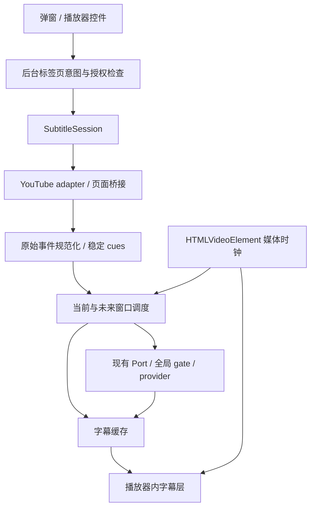

# YouTube 双语字幕设计

状态：G0 通过，首版功能已实现，发布前实网覆盖仍有待补项。更新日期：2026-10-25。字幕源证据见 [G0 验证报告](../research/youtube-subtitles-g0.md)，实现、浏览器测试和剩余边界见[首版验收记录](../testing/youtube-subtitles-v1.md)。
代码基线：`4a1c5cc20f4683a344384bede5a891a78036e07e`。开发分支：`dev-youtube-bilingual-subtitles`。
仓库已存在 `dev` 分支，故无法创建 `dev/…`，本次保留原分支并采用上述名称。

交互草图：[youtube-subtitles-preview.html](./youtube-subtitles-preview.html)。它是独立、无外部网络资源的本地设计样例，不运行真实视频、不调用模型、不修改扩展设置。

## 1. 产品目标与核心决定

用户打开一个有字幕的 YouTube 视频，点击“开启双语字幕”，即可继续观看原文与译文。已经配置过 Dual Read 的用户不需要再配置服务、模型或源语言。

1. **零新增必填设置。**沿用现有翻译连接；字幕目标语言默认跟随全局目标语言。源轨道自动选择，用户可通过 YouTube 原生字幕菜单纠正。
2. **观看优先。**原文在上、译文在下；不自动暂停、不弹模态框、不增加侧栏或悬浮球。
3. **入口少且明确。**YouTube 弹窗提供“字幕 / 网页”两个范围；授权启用后，播放器只增加一组“双语开关 + 选项”控件。
4. **低频设置渐进展开。**只提供字幕目标语言、字号三档、顶部/底部、自动开启。没有第二套 API 配置，也不向普通用户暴露抓取方式、token、批次、预取或并发。
5. **原生字幕随时可恢复。**失败时保留原文；关闭后只撤回扩展拥有的改动。用户手动关闭后，站内切视频不擅自重新开启。
6. **独立字幕会话，复用翻译基础设施。**新增字幕源、规范化、调度与显示；复用 Port、provider、凭证、限流和缓存机制。首版无需修改 Go 代理。

以上是本项目的产品决定，不是对竞品效果的测量结论。

## 2. 调研依据与取舍

基础约束见[上一轮架构调研](../research/youtube-bilingual-subtitles.md)。三个开源项目的固定提交、实际源码及许可事实见[现成实现调研](../research/youtube-subtitle-implementations.md)；下表的 `OSS/R…`、`OSS/B…`、`OSS/D…`、`OSS/U…` 对应该文档的证据编号。

| 参照 | 已核对的做法 | 本项目采纳 | 不纳入首版的部分 |
|---|---|---|---|
| Read Frog | 当前播放器桥接、真实字幕请求、不同字幕格式解析、时间窗口预译、旧结果隔离（OSS/R1–R11） | 职责分离、有限预译、cue 身份与会话代次 | 安装后常驻所有相关页面、独立字幕 provider/prompt/速率表单、AI 分句配置 |
| BilingualTube | 较少的常用设置、原生样式采样、双行 overlay（OSS/B1–B8） | 简单控制和现有配置复用 | 将私有 onVideoProgress 作为唯一时钟；照搬其 cleanup 接线或简单缓存键 |
| yt-dual-subs | 主按钮切换、箭头展开、原生 CC 改动标记、轨道失败后的 DOM 降级（OSS/D1–D8） | 一组播放器控件、可逆接管、有限降级 | 复杂逐行样式、拖动、朗读、摘要、导出；按时间近邻猜测译文配对 |
| 沉浸式翻译 | 官方说明复用播放器原文字幕、选定服务翻译、一次原文恢复（OSS/U3–U4） | 减少重复字幕请求、先自行恢复再展示可操作错误 | 将私有实现当成已验证源码；默认转到额外翻译服务 |
| Language Reactor | 功能开关、词典、逐句暂停、多组快捷键（OSS/U5） | 易于发现的启停入口 | 学习侧栏、词卡和接管播放节奏 |

范围过滤：优先解决观看中的字幕翻译，不把竞品的功能数量当作需求。对象过滤：三个开源实现的提前注入前提与 Dual Read 按需注入不同；必须先通过中途启用验证。闭源产品仅以官方文档作为行为说明，未验证其内部代码。源码可见的实现也不代表对任意视频稳定可用。

## 3. 首版范围

| 纳入 | 暂缓 |
|---|---|
| 桌面 `https://www.youtube.com/watch` 点播页 | Shorts、第三方嵌入、移动版页面 |
| 可取得的人工字幕、自动生成字幕 | 无字幕音频识别、直播增量字幕 |
| Chromium 与 Firefox 当前仓库支持版本 | Safari、普通系统 PiP、Document PiP |
| 原文 + 译文上下两层，暂停、seek、倍速、广告恢复 | 逐词高亮、词典、逐句暂停、朗读、导出 |
| 正常、剧场、播放器全屏 | 用户 CSS、任意字体/颜色/描边、字幕拖动 |
| 当前音轨与已识别字幕轨正确对应；变化时重新校验 | 无法可靠识别的多音轨自动匹配；不猜测映射 |

首版固定双语显示，不继承网页 `mode: replace`。每种语言是一层，长句允许自然折行，不能把“双行”解释为任意长度都压成两个物理行或截断文本。

## 4. 用户路径

### 4.1 已配置翻译服务的首次使用

1. 用户打开 YouTube 视频，再点击扩展工具栏图标。以 `activeTab` 权限做轻量播放器探测，弹窗默认展示“字幕”页签；此时不发送字幕或启动翻译。
2. 目标语言显示“跟随默认 · 简体中文”（按真实配置替换）。主按钮是“开启双语字幕”。没有源语言、模型或全局启用开关需要先填写。
3. 点击后初始化字幕会话和页面桥接，保留原生字幕，显示“正在准备字幕…”。如需触发字幕请求，可在记录原始状态后受控开启原生 CC。
4. 当前片段取得原文后显示原文；译文就绪后填充第二层。后台只预译附近未来片段，视频继续按原状态播放。
5. 播放器新增“双语 ▾”控件，之后可以直接关闭或调整。弹窗和播放器反映同一个状态。

若尚未配置翻译服务，主按钮改为“设置翻译服务”，进入现有连接/引导页面，完成后回到视频主动开启。不要新增字幕专用 onboarding 或第二份密钥。

### 4.2 日常启停

- 主按钮一击开/关；箭头只打开选项，不顺带切换启用状态。
- 手动选择保存在当前标签页的临时意图中，同源导航与 SPA 换视频沿用。关闭后下一条视频仍保持关闭；页面重建时只有权限仍有效才恢复该意图。
- 标签页关闭、导航到其他源或浏览器会话结束后清除临时意图。新标签页按“自动翻译 YouTube 字幕”偏好决定，默认关闭。
- 因错误临时停止显示，不等于用户主动关闭；但不得无限重试。同一故障需要有界恢复或用户点击重试。
- 字幕关闭不停止网页翻译；网页“恢复原文”只恢复网页内容。两个入口分别有清晰作用域。扩展卸载、更新或全局禁用时统一清理全部自有 UI。

### 4.3 自动开启

“自动翻译 YouTube 字幕”默认关闭，位于字幕选项里。首次打开时只申请 `https://www.youtube.com/*` 权限；被拒绝则保持关闭，当前手动会话仍可使用。

设置成功后，新的 YouTube 标签页可自动注入；注册仅限所需源的轻量启动脚本，不注入所有网站。用户已经明确关闭的标签页仍保持关闭。关闭自动开启会注销后续启动，不强行终止手动开启中的会话。权限撤销时停止自动注入；仍有临时权限的手动会话按实际权限判断继续。

自动开启偏好属于设备本地，导入/同步设置不能绕过当前设备授权。现有站点“从不翻译”优先于字幕自动与手动开启；弹窗显示原因并提供修改该站点规则的入口。原来的“自动翻译网页”不会升级成自动翻译字幕。

## 5. UI 设计

### 5.1 扩展弹窗

保持现有 280px 宽度、系统字体、蓝色强调色和深色模式。只有支持的视频页增加范围页签；普通网页保持原有界面。页签是视图选择，切换页签不会开启、停止或恢复任何任务。

```text
┌────────────────────────────┐
│ Dual Read                  │
│ [ 字幕 ]      [ 网页 ]      │
│                            │
│ ● 正在显示双语字幕         │
│ 英语 · 自动字幕            │
│                            │
│ 译成                       │
│ [ 跟随默认 · 简体中文   ▾ ] │
│                            │
│ [     关闭双语字幕       ] │
│ 字幕使用已配置的翻译服务。 │
│                            │
│ ▸ 字幕选项                 │
│                      设置  │
└────────────────────────────┘
```

默认界面只有一个语言选择和一个主操作。来源语言/人工或自动字幕是只读状态，只有识别到才显示；不展示“已翻译 184/392 条”之类与观看关系不大的数字。主操作开启时使用蓝色，关闭时使用中性按钮。

“网页”页签保留现有页面翻译控制。原有 `Alt+T`、`Alt+M` 不改成字幕快捷键；首版不新增默认快捷键以避免冲突。之后可提供用户自行绑定的字幕命令。

### 5.2 播放器控制

控件形态：`[ 双语 ][ ▾ ]`，插在播放器右侧原生控制组中、靠近 CC；不替换原生 CC 或齿轮。选择器集中由 adapter 管理，找不到可靠容器时保留弹窗入口，不在页面角落另造悬浮球。

- 主体 `button` 一击切换，`aria-pressed` 表示状态；打开时使用蓝色强调及底部标记，不能只靠颜色表达。
- 箭头 `button` 的标签为“字幕选项”，设置 `aria-expanded` 和 `aria-controls`。两处点击目标均至少 24×24 CSS px，高度随原生控制条；不得挤掉全屏或 CC。
- 跟随原生控制条显隐；选项面板打开或键盘焦点位于控件时保持可操作。正常播放时不常驻一块工具栏。
- 首次手动开启前不植入该按钮。已经启用过的当前页面关闭字幕后，可以保留闲置按钮供重新开启；页面销毁或退出 YouTube 时清理。
- 窄播放器无法容纳时，优先保留一个简短主按钮，次要设置仍从弹窗可达；不缩到不可点击。

选项面板锚定控件上方，宽约 264px，限制在播放器内；短播放器允许面板内部滚动。面板使用非模态带标签的 dialog/popover，不锁住视频播放。

| 控件 | 默认 | 修改影响 |
|---|---|---|
| 译成 | 跟随全局默认目标语言 | 仅改变字幕目标；返回“跟随默认”可移除覆盖值 |
| 字号 | 标准 | 小/标准/大，立即预览，不重新翻译 |
| 位置 | 底部 | 顶部/底部，立即预览，不重新翻译 |
| 自动翻译 YouTube 字幕 | 关闭 | 设置本机 YouTube 自动启动偏好；需要的权限在用户点击时申请 |

原文语言跟随 YouTube 字幕选择；需要纠正时，提示在原生字幕菜单中切换。面板不加入引擎、密钥、原文/译文顺序、速度或调度参数。原生齿轮仍由 YouTube 管理；不承诺原生的所有字体样式都作用于自有字幕层。

### 5.3 字幕外观与可访问性

- 原文在上、译文在下，两层居中且共用对齐宽度；原文略小，译文略大，使用白色文字、稳定的深色半透明底与轻微描边。复用系统字体，避免额外字体下载。
- 字号按实际播放器尺寸缩放；底部留出原生控制条安全区，显隐控制条不导致字幕频繁跳动。顶部预设留出标题区域。文本最大宽度约为画面的 88%，允许自然折行，不 ellipsis 截断。
- 空字幕时不留背景框；译文未到时仅保留原文，不显示上一句译文，不逐句闪烁“翻译中”。
- 字幕区域默认 `pointer-events: none`，不拦截点击暂停、拖进度条和鼠标手势。控件区域单独响应交互，不全屏覆盖透明事件层。
- 不将每条字幕设为 aria-live，避免辅助技术每句被打断；只对状态变化使用简短 `role=status`。标注两层的 `lang` / `dir`，源字幕也可能为 RTL。
- Tab 可访问主按钮与箭头；Enter/Space 操作；Esc 仅在选项面板打开时关闭它并回到箭头，避免无故截获退出全屏。点击外部关闭面板；不抢走视频焦点。降低动态效果偏好下无加载旋转或位移动画。

## 6. 状态与恢复文案

状态只在弹窗或用户打开的选项中解释。播放器按钮可用小状态标记；不弹窗、不发系统通知、不遮住画面。以下文案是产品文案示例，需要进入现有本地化目录。

错误或无字幕发生在用户开启之后时，仍保留开启意图；播放器主体仍可直接关闭。弹窗主操作可显示重试/重新检查，同时在其下保留“关闭字幕翻译”文字按钮，保证即使播放器控件未挂载也能明确关闭。只有用户关闭时才把标签页意图写为 false，不能删除覆盖值后立即回到自动开启。

| 状态 | 文字 | 主操作 | 视频/字幕行为 |
|---|---|---|---|
| 未开启 | 双语字幕未开启 | 开启双语字幕 | 原生播放保持 |
| 无连接 | 先设置翻译服务 | 设置翻译服务 | 不调用模型 |
| 准备中 | 正在准备字幕… | 取消 | 保留原生字幕；可继续播放 |
| 已开启 | 正在显示双语字幕 | 关闭双语字幕 | 按媒体时钟显示 |
| 译文追赶 | 正在准备接下来的译文 | 关闭双语字幕 | 先显示当前原文；不自动暂停 |
| DOM 降级 | 已切换为实时字幕，译文可能稍晚 | 关闭双语字幕 | 翻译当前可见字幕；过期结果不显示 |
| 原生自动译文且原轨不可用 | 请将 YouTube 字幕切回原始语言后翻译 | 重试 / 关闭 | 保留原生显示，不二次翻译；切回原始语言后自动重新准备 |
| 确认无轨道 | 这个视频暂无可用字幕 | 重新检查 | 原生播放保持，不启动录音 |
| 字幕源受限 | YouTube 暂时无法提供字幕，请稍后重试 | 重试（冷却中禁用） | 不循环切轨/刷新，不伪报“无字幕” |
| 翻译失败 | 翻译服务连接失败，已保留原文 | 重试 | 清除旧译文；保留原文 |
| 凭证无效 | 翻译服务需要重新连接 | 检查连接 | 不无限重试鉴权错误 |
| 同语言 | 原文已是所选语言，直接显示原文 | 关闭字幕显示 | 不发无意义翻译请求，不重复显示同一句 |
| 站点禁用 | 此网站已设为从不翻译 | 修改站点规则 | 不注入字幕引擎 |

字幕源正常但模型持续失败时，恢复原生字幕显示并停止自动尝试，保留可重试状态。如原本 CC 关闭，用户点击重试前仍可保留当前原文作为明确的临时失败状态；用户关闭功能时按所有权契约恢复最初的 CC 状态。不要为“看起来成功”而自动切到第三方免费服务。

## 7. 设置和状态所有权

建议 `Settings.schemaVersion` 从 4 迁移到 5；迁移只填默认值，已有页面语言、mode、站点规则和密钥不变。

```ts
interface SubtitlePreferences {
  targetLang: TargetLang | null; // null: follow Settings.targetLang
  textSize: 'small' | 'medium' | 'large'; // medium
  position: 'bottom' | 'top'; // bottom
}

interface SubtitleLocalPolicy {
  youtubeAuto: boolean; // false; device-local, permission-gated
}

interface SubtitleTabIntent {
  origin: 'https://www.youtube.com';
  enabled: boolean; // explicit user intent, overrides auto for this tab
}
```

- 非敏感显示偏好使用现有设置持久化；`youtubeAuto` 放设备本地并接入 `splitPersistence`，不要因同步或导入在另一台设备自动启用。导入可恢复语言/样式，自动开启仍需本机点击和实际权限。
- 临时标签页意图由后台以 tabId 保存在 `storage.session`，不存 cookie、URL 查询串或字幕全文；后台休眠不能让用户的“关闭”丢失。tab 关闭/跨源导航时删除，恢复浏览器会话不自动推断旧 tabId。
- 标签页意图与文档会话身份分开：刷新/重注入后由 content 实例 ID 建立新的 sessionId 和代次，继续拒绝旧实例结果；手动关闭的意图仍保留。
- `enabled` 是用户意图，`status` 是能力/处理状态，两者分开。导航时重置字幕会话和错误，不把用户意图重置为默认。
- 配置优先级：站点禁用 → 实际权限 → 标签页明确意图 → 本机自动偏好。字幕目标覆盖值为 null 时读取全局 targetLang，不继承网页站点模式。UI 明确显示“跟随默认”，避免隐式修改网页语言。
- sourceTrack 属于当前视频会话，不是全局用户设置。换轨/语言/模型会新建翻译代次；字号/位置只重绘。新增字幕偏好不能通过现有全局 revision 比较无差别销毁网页翻译会话，应区分 provider/字幕内容/字幕外观的变更。
- Options 只在现有“翻译与显示”中增加一个折叠“视频字幕”区，复用上述偏好，不新增主导航或独立配置页。字幕界面的“设置”仍进入已有连接设置。

## 8. 实现结构



### 8.1 按需字幕获取

1. 在当前主 frame 注入隔离环境的会话代码；需要读取播放器 JavaScript 时才运行主世界桥接。普通 watch 页不复用 `allFrames` 广播初始化字幕。
2. 读取当前播放器身份/轨道及会话内已有字幕数据；验证 URL 中 videoId、播放器 videoId 和响应 videoId 一致。`ytInitialPlayerResponse` 只是候选，不是 SPA 后的唯一权威。
3. 优先复用已取得的原文响应；中途启用时可扫描仍存在的字幕 Resource Timing URL，并观察后续的 XHR/fetch。Resource Timing 只有元数据，不能凭它恢复已消失的响应体，也不保证请求 URL 一定可重放。
4. 若只有有效轨道 URL，在原页面会话中有界请求；保留必要签名/会话参数。自动翻译轨尽可能定位回对应原文，避免翻译已机翻的内容。不把抓取 YouTube 的职责放到 Go 代理。
5. 需要新请求时，记录原生 CC/轨道状态后受控触发一次。是否能可靠触发属于 G0 验证；不能循环开关 CC。若用户在此期间改过状态，中止接管并遵从用户操作。
6. 主路径失败但原生字幕确实在更新时，自动降级当前 CC DOM；同一 MAIN 快照核对轨道状态与文字，不把原生自动译文当作原文。原生自动翻译开启时保留原生显示并提示切回原始语言。元数据缺失属于未知状态，与确认空轨道区分；有界等待后可由状态轮询检测就绪并恢复。两种来源均不可用则分类报错。source-fetch 429 与 provider 429 分开，恢复预算分开。

源适配集中处理私有字段、选择器和网络观察。桥接消息严格限定 schema/大小/类型，带 requestId/videoId/generation；source/origin 与随机关联 token 只防串话，不把主世界当成可信身份边界。页面不能通过桥接发任意 URL 请求或指定系统 prompt。凭证留在后台。

实现采用自包含函数经 `scripting.executeScript({ world: 'MAIN' })` 读取播放器，并结构化回传。G0 诊断工具的页面消息 relay 仅供测试驱动。生产入口为 `youtube-subtitles.ts`，持续会话复用后台 Port；Chromium / Firefox 工具栏的实际 `activeTab` 手势另行验证，见验收记录。

页面 hook 只观察匹配的字幕请求，不修改无关请求；读取响应使用不消费原始响应的副本。停止时移除观察器；只有全局函数仍是自身 wrapper 时才恢复，避免覆盖其他脚本后来的包装。没有注册全站常驻监听的必要。

### 8.2 数据、翻译与缓存

- 控制消息独立为 `startSubtitles`、`stopSubtitles`、`getSubtitleStatus`、`updateSubtitleAppearance`，保留现有页面消息含义。字幕 Port 请求使用独立 `translateSubtitles` 类型，携带 requestId/sessionId、videoId/trackId/generation、带 id/revision 的文本项、有限上下文、targetLang 和 providerFingerprint；不携带密钥。
- 后台验证 sender 的 tab/frame、已授权且仍启用的会话、任务类型、目标语言和请求大小，再用可信设置选择字幕 prompt 与连接。返回结果携带相同身份。状态进度使用已就绪时间窗口/当前状态，不混入现有页面翻译计数。
- Cue 至少含稳定 id、startMs、endMs、sourceText、sourceRevision；轨道含 videoId、trackId、sourceLang、manual/asr、trackRevision。原始事件和归一化结果分开，便于回放排查。
- 人工字幕与自动滚动字幕分别规范化。对重复、追加、词级 offset、空事件、窗口及重叠建立样本测试；不按纯文本跨时间去重，不丢词，不用模型猜时间戳。首版关闭 LLM 智能分句，避免先增加时延和对齐变量（OSS/R4、B2、U1）。
- 自己翻译的结果按 cueId 对应，不用第二条译轨按数组下标或近邻时间拼接。字幕专用 parser 验证 ID 集合、唯一性和字符串类型，失败只重试缺失/无效条目；不用当前网页 parser 的按行猜测或广播原始串兜底。
- 批次带有限相邻上下文，上下文从轨道中稳定选取，不能因部分命中缓存而改变。所有正文都作为待翻译数据，后台生成固定字幕提示词，明确不执行字幕中的指令。
- 新增字幕 namespace，key 至少含 provider 指纹、字幕 prompt/规范化版本、sourceLang、targetLang、sourceText、contextHash；轨道缓存另按视频+轨道+修订保存。保留 TTL/LRU、隐身不落盘和全局清缓存语义。
- 同步原始语言使用轨道 metadata，不把源语言限制成当前 TargetLang 枚举。源目标相同时跳过模型调用；不凭一两个字符的启发式替代轨道身份。

### 8.3 调度与显示

- 当前缺译 cue 优先，其次近期未来窗口；初始候选参数为未来 30 媒体秒、每批最多 5 个片段，并受字符预算约束。最多 2 个在途请求且不超过现有 maxConcurrent。它们是待基准测试调整的内部默认值，不出现在用户设置中。
- 倍速扩大媒体时间预取窗口，同时设置条数/字符/时间上限。每个会话最多一个待提交预取批次，seek 后移除旧窗口任务；不把全片排入现有全局 FIFO。先复用全局 gate 上限，再以测量决定是否需要引入公平的优先级调度。
- 记录排队到回包的实际耗时，评估未来窗口；短暂停留不启动全片翻译。暂停时只补有限缓冲后停止新增请求；用户关闭后取消全部相关 Port/请求。
- 使用 `video.currentTime` / 可用的 `requestVideoFrameCallback.mediaTime`；播放中可回退为 requestAnimationFrame/timeupdate。seek、pause、ratechange、loadedmetadata 立即校准，不能把私有播放器事件当唯一时钟。
- 显示资格同时要求：当前视频/轨道/代次/cue修订匹配，且媒体时间位于该区间。过期 cue 的结果可留在同身份缓存，不得立即画到屏幕；跨身份旧结果直接丢弃。
- 标准不重叠 cues 可用游标与二分查找；有重叠时先用明确规范化策略处理，不默认所有字幕数组天然不重叠。只在 cue 或翻译版本变更时写 DOM。
- 广告期间隐藏正片字幕并暂停正片任务调度；返回正片后重新核对播放器/视频身份，不拿广告 currentTime 索引正片。播放器替换、导航和重注入都走幂等 dispose。

### 8.4 原生 CC、布局与清理契约

- 接管前记录原生 CC 开关、轨道、扩展改动标记与观察到的用户修订。只有扩展实际改变过且用户未再修改的值，关闭时才恢复；恢复原生“可见样式”与恢复“CC 开关”是两件事。
- 取得可靠原文并挂好自有层后才局部隐藏原生字幕。用自有 class/style 控制显示，不移除或改写原生字幕节点；不要通过关闭 CC 破坏正在使用的数据源。
- 用户通过原生 CC 主按钮、字幕菜单或快捷键关闭字幕时，视为明确关闭双语并清理，不能马上替用户重新开 CC。用户重新开启原生 CC 只显示原文，不自动发起翻译。切换源语言时重新校验轨道，并保留用户选择；倍速等非字幕设置不取消扩展的恢复责任。
- 所有 UI 带明确自有标记；collector 与 RootRegistry 都排除自有 Shadow host/字幕区域，防止网页翻译再次翻译字幕或形成观察循环。不要仅依赖 Shadow DOM 样式隔离。
- host 挂在当前播放器全屏容器内；全屏/剧场/尺寸变化更新位置。无法可靠定位时保留原生字幕并报告，不在 body 上无限提高 z-index。
- dispose 移除自有节点/样式、监听器、计时器、帧回调、请求和bridge；对跨 SPA 的用户意图只在后台保留必要状态。恢复遵循仓库 DOM restoration 合同，不覆盖页面后来新增的节点、顺序或编辑。

## 9. 代码落点和实施拆分

| 阶段 | 主要落点 | 可审查交付与完成条件 |
|---|---|---|
| G0：获取验证 | `lib/subtitles/youtube-adapter.ts`、临时诊断与脱敏 fixtures | 人工/ASR，CC 开/关，初次/中途启用，SPA 后得到身份正确的非空时码；证实恢复 CC 和两种浏览器桥接。失败边界写入能力矩阵 |
| G1：人工字幕闭环 | `lib/subtitles/{types,session,renderer,youtube-lease}.ts`，`messaging.ts`、background、popup、`entrypoints/youtube-subtitles.ts`、collector/roots | 独立启停、字幕专用请求/解析、当前 cue 显示、基本预取、全屏和完整清理；首次引入字幕层时即完成自有 UI 采集排除及最小共存回归 |
| G2：自动字幕与故障 | `normalize.ts`、provider 字幕 prompt/parser、cache | ASR 样本回放、上下文/缓存隔离、DOM 降级及其共存回归、source/provider错误区分、seek/广告/旧结果测试 |
| G3：简约交互与发布 | settings schema/storage/transfer、popup/player controls、options、locale、privacy/store docs | 同步所有入口状态；四项低频偏好；自动启动权限/撤销；新构建 Chromium/Firefox 完成验收 |

上表为建议的新文件路径。现有 `lib/scheduler/session.ts` 仍负责网页文本，不承载视频调度。可以从 provider 中抽取共用 HTTP helper，但不为字幕复制整套鉴权/连接逻辑。服务端沿用非流式批次请求；不以本次设计为由增加抓取、ASR 或 WebSocket 服务。

G0 是有条件实施的前置关卡：如果按需获取无法满足主路径要求，记录证据后收缩为明确标识的 DOM 模式或暂停完整轨道能力；不能悄悄改成安装时读取所有网站来满足设计。

## 10. 验收标准

以下保留设计的检查标准；勾选项有首版证据，未勾选项含尚未全面覆盖的子项。具体环境和测量见验收记录，不能把局部通过理解为所有真实视频均可用。

### 用户与 UI

- [x] 已配置的用户从弹窗一次点击即可开启，无新增必填项；未配置者复用既有连接引导。
- [x] 主体按钮一击开/关，箭头不改变开关；弹窗和播放器状态一致，重复启用不增加第二组控件。
- [x] 字幕目标语言变化不改变网页目标；外观变化不请求模型、不销毁网页翻译。
- [x] 首次手动启用前不注入播放器 UI；未开启自动功能时不申请持久 YouTube host 权限。
- [ ] 自动授权被拒绝时保持关闭；手动关闭后站内切视频不重新启用；权限撤销、tab关闭、跨源导航按契约清理。
- [x] 无模式切换、源语言表单、第二套provider表单、预取/并发等常用设置；低频面板仅四项。
- [ ] 普通/剧场/全屏、窄播放器、200%缩放、深色/高对比、键盘焦点均可用；菜单不越界、不挡 CC/全屏。

### 正确性与恢复

- [x] 人工/ASR字幕在合成与真实脱敏样本中无丢词；重复文本不跨时刻误去重；所有译文均能追溯到对应 cue ID。
- [ ] 暂停、0.5/1/2倍速、前后seek、跳转后立即换视频、广告/播放器重建不串句。
- [ ] 对模拟缓慢响应、断网、429、鉴权失败、坏JSON和缺ID给出有限恢复；没有无限spinner或请求风暴。
- [x] 确认无字幕与获取失败文案不同；不自动录音、暂停视频或更换provider。
- [x] 关闭/失败/重注入恢复原生字幕显示；原生CC初始关/开与用户中途改设置均有独立测试。
- [ ] 清缓存、改源/目标语言、换模型/提示词/上下文不误用旧结果；隐身字幕缓存不落盘。
- [x] 网页翻译与字幕翻译共存时不采集自有UI，不破坏原生CC，不形成 MutationObserver 循环。

### 测量与执行

使用本地播放器 fixture 和可控 mock API，记录首条译文耗时、当前 cue 译文就绪率、旧结果丢弃数、每分钟请求数与缓存命中。网络翻译延迟和本地绘制偏差分别测量；不把竞品的30秒/5段参数当作已经验证的本项目最优值。

为“已缓存字幕”的本地fixture设定候选目标：前台正常播放时显示切换偏差不超过150ms，seek完成后250ms内反映正确片段；这些是验收目标，需在目标浏览器/设备上确认可行后锁定。模型未完成时不承诺相同延迟，必须保留原文且不显示旧译文。

实现后运行 TypeScript、ESLint、Vitest 和新构建 Chromium/Firefox E2E。现有 Playwright `testMatch` 是白名单，需显式接入新增 spec 或共享场景。真实 YouTube 再覆盖登录/未登录、人工/ASR/无字幕和中途启用；本地fixture通过不能替代真实源验证。

## 11. 未决项与本次交付边界

- [G0 实测](../research/youtube-subtitles-g0.md)已在登录态 Chromium 中验证人工 / ASR、播放中途、CC 恢复与真实 SPA；未登录独立配置仍存在空响应，Firefox 登录态线上尚未验证，不能由局部成功推断所有环境成功率。
- JSON3 人工/ASR 规范化已实现，有真实脱敏回放；多音轨、全部 JSON3 变体和 YouTube 后续接口变化仍需持续补样本。
- 模型延迟与首版参数：使用用户实际provider做有界测试后调整，不暴露一组让用户自行试错的性能设置。
- 参考项目的许可文件已记录；本次借鉴设计原则并独立设计，没有复制其实现或新增依赖。
- 初始静态草图未通过内置浏览器的本地文件限制；后续验收直接使用新构建的真实扩展、受控播放器和浏览器原生工具栏，不将草图当作功能证据。播放器里的第四项“自动开启”链接直达现有设置页的字幕区域；真正的权限申请在扩展页面内由用户触发，弹窗与设置页提供开关。

当前设计主张保持稳定：先验证字幕源，以有限预译和严格时间身份保证正确性，再用一个开关和少量预设交付可用体验。
