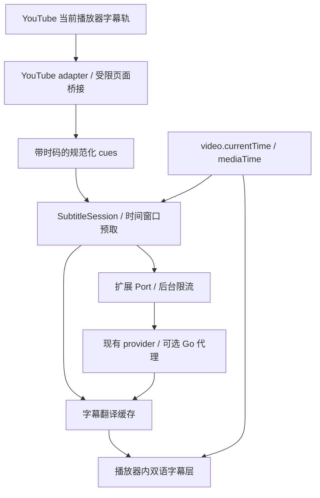

# Dual Read 增加 YouTube 双语字幕：调研与实现建议

调研日期：2026-10-24。仓库基线：`4a1c5cc20f4683a344384bede5a891a78036e07e`，扩展版本 `0.1.1`，锁定 WXT `0.19.29`。本文是源码和原始资料调研及设计建议；没有实现字幕功能，也没有在真实 YouTube 页面验证字幕抓取成功率或播放效果。

后续已补充[现成实现源码比较](./youtube-subtitle-implementations.md)和[产品与技术设计](../design/youtube-bilingual-subtitles.md)。本文件保留前期证据；具体设置、交互和默认值以设计文档为准。

## 调研约定（Charter）

- 目标：判断是否适合在当前项目增加 YouTube 双语字幕，明确可复用模块、新增边界、获取路径、实施顺序与可检查的验收条件。
- 范围 / 对象 / 研究单元：桌面浏览器中的 YouTube 字幕翻译 / Dual Read 扩展及可选 Go 代理 / 字幕轨获取、翻译请求与缓存、播放时间轴、双语展示、会话清理。
- 类型：探索性研究，并形成有条件的实施交接；网页内部接口的实际可用性仍需原型验证。
- 知识深度：调研前对项目仅表面了解；调研后对源码和公开接口具备工作级理解，运行效果未验证。
- Q1：现有翻译、调度、缓存、渲染和服务端分别能复用多少？
- Q2：如何取得字幕，公开 API、网页轨道和 DOM 降级各有什么限制？
- Q3：如何保证双语字幕与播放、跳转、倍速、切换视频和全屏同步？
- Q4：首版改哪些模块，如何验收，无字幕、直播和画中画有哪些边界？
- 完成标准：以上问题均有源码/原始资料依据或明确列为待验证；不以设计建议代替实际测试结果。

## 权威来源（Canonical sources）

| 优先级 | 来源 | 用途 |
|---|---|---|
| 1 | YouTube Data API 与 IFrame API 官方文档 | 公开接口及权限合同 |
| 1 | YouTube Help | 字幕、文字稿、自动字幕和直播的产品边界 |
| 1 / 3 | yt-dlp、YouTube.js 作者维护的原始源码与文档 | 证明第三方工具如何处理网页字幕数据；不代表 YouTube 的兼容性承诺 |
| 1 / 2 | Chrome 官方文档、WXT 文档、MDN | 浏览器权限、执行环境和显示边界 |
| 3 | 当前仓库的入口、类型、调度器、provider、缓存、Go handler、测试与权限文档 | 确定本项目的实际复用边界，而非根据 README 推测 |

外部源码已固定：yt-dlp `fa9886678eb65103303c627b8e013f13f8999b41`（2026-10-23），YouTube.js `204715b6acfb063dc306d8677e36fdbf09f293c5`（2026-10-23）。原始源码已重新打开核对；未使用搜索摘要或第三方教程作为核心证据。当前 WXT 网站显示 `0.21.4`，其示例仅证明机制，不能直接视为本仓库 `0.19.29` 的版本契约。

## 证据台账（Findings ledger）

| 编号 | 已核实事实 | 证据 | 等级 | 问题 |
|---|---|---|---|---|
| E1 | `captions.list` 需要 OAuth 授权，返回字幕轨元数据而非字幕内容。 | [YouTube captions.list](https://developers.google.com/youtube/data/reference/rest/v3/captions/list)，Authorization / Response | 1 | Q2 |
| E2 | `captions.download` 明确要求调用用户具有视频编辑权限；其 `tlang` 机翻能力也受此入口权限限制。 | [YouTube captions.download](https://developers.google.com/youtube/data/reference/rest/v3/captions/download)，方法说明与 `tlang` | 1 | Q2 |
| E3 | IFrame API 针对嵌入播放器；公开字幕模块选项为 `fontSize` 与 `reload`，文档没有提供读取字幕文本的 API。 | [IFrame API](https://developers.google.com/youtube/iframe_api_reference#onApiChange) | 1 | Q2 |
| E4 | yt-dlp 从 player response 的 `captions.playerCaptionsTracklistRenderer.captionTracks` 中取得 `baseUrl`，通过 `kind == asr` 区分自动字幕，并支持 `json3` 等输出格式。 | [yt-dlp _video.py](https://github.com/yt-dlp/yt-dlp/blob/fa9886678eb65103303c627b8e013f13f8999b41/yt_dlp/extractor/youtube/_video.py)，`_SUBTITLE_FORMATS` 与第 4214–4332 行 | 1 / 3 | Q2 |
| E5 | 当前 yt-dlp 字幕提取分支检查客户端字幕 PO token 策略及 `exp=xpe/xpv`，在需要 token 却没有 token 时跳过该客户端字幕。 | [yt-dlp _video.py](https://github.com/yt-dlp/yt-dlp/blob/fa9886678eb65103303c627b8e013f13f8999b41/yt_dlp/extractor/youtube/_video.py)，第 4263–4286 行 | 1 / 3 | Q2 |
| E6 | yt-dlp 维护者将字幕请求列为可能需要 PO token 的用途；token 存在会话或视频绑定、有效期及不断变动的实施策略。 | [yt-dlp PO Token Guide](https://github.com/yt-dlp/yt-dlp/wiki/PO-Token-Guide)，Cases / Technical details | 1 | Q2 |
| E7 | YouTube.js 对字幕轨解析包括 `base_url`、`vss_id`、`language_code`、`kind`、`is_translatable`，并独立解析音轨与字幕轨索引关系。 | [PlayerCaptionsTracklist.ts](https://github.com/LuanRT/YouTube.js/blob/204715b6acfb063dc306d8677e36fdbf09f293c5/src/parser/classes/PlayerCaptionsTracklist.ts) | 1 / 3 | Q2 |
| E8 | Chrome content script 默认运行在 isolated world，不能直接读取网页脚本的 JavaScript 变量；DOM 可以共享。 | [Chrome content scripts](https://developer.chrome.com/docs/extensions/develop/concepts/content-scripts#work_in_isolated_worlds) | 1 | Q2、Q4 |
| E9 | 当前 WXT 文档介绍 `injectScript` 注入 unlisted script 到主世界及相应 web accessible resource；不代表仓库锁定版本已验证。 | [WXT content scripts](https://wxt.dev/guide/essentials/content-scripts.html#isolated-world-vs-main-world) | 1 | Q2、Q4 |
| E10 | Chrome 内容脚本的跨域请求仍受网页源的限制；扩展后台可通过目标 host permission 发跨域请求；不能开放任意 URL 代理。 | [Chrome network requests](https://developer.chrome.com/docs/extensions/develop/concepts/network-requests) | 1 | Q2、Q4 |
| E11 | YouTube 对有字幕的视频提供 Show transcript；可点击文字稿的某一行跳到对应播放位置。 | [View video transcripts](https://support.google.com/youtube/answer/15930243?hl=en) | 1 | Q2 |
| E12 | YouTube 自动字幕可能尚未完成处理、语言不支持或因音质等因素缺失；多音轨视频的自动字幕对应默认语言，不能直接当作任意当前音轨的原文。 | [Use automatic captioning](https://support.google.com/youtube/answer/6373554?hl=en)，Automatic captions / Troubleshoot | 1 | Q4 |
| E13 | 官方文档称直播自动字幕当前限英语和 normal latency；直播结束后会重新生成 VOD 自动字幕，内容可能不同。 | [Use automatic captioning](https://support.google.com/youtube/answer/6373554?hl=en)，Automatic captions on live-stream videos | 1 | Q4 |
| E15 | 一个原始应用实现的 `parse_json3` 读取 `events[].tStartMs`、`dDurationMs`、`segs[].utf8`，处理无文字事件，并裁剪重叠时间以输出 SRT。这是该应用的简化策略，不是完整 JSON3 规范。 | [openshorts free_tools.py](https://github.com/mutonby/openshorts/blob/main/free_tools.py#L211-L235)，main，2026-10-24 检索 | 3 | Q2 |
| E14 | 普通 video PiP 显示单个视频；任意 HTML 内容属于另一个 Document PiP API 的能力。 | [MDN Picture-in-Picture](https://developer.mozilla.org/en-US/docs/Web/API/Picture-in-Picture_API) | 2 | Q4 |
| R1 | 扩展采用 MV3、`activeTab` 与 `scripting` 按需注入；Firefox 最低版本为 140；WXT 锁定为 0.19.29。 | [wxt.config.ts](../../extension/wxt.config.ts) 第 10、32–35、55、65 行；[package-lock.json](../../extension/package-lock.json) 第 8263 行 | 3 | Q1、Q4 |
| R2 | `TranslationUnit` 持有 `HTMLElement`，没有字幕时间戳；定向源码检索未发现 YouTube、timedtext 或 TextTrack 管线。 | [types.ts](../../extension/lib/types.ts) 第 77–87 行；2026-10-24 对 `lib/`、`entrypoints/`、`tests/`、`e2e/` 的检索 | 3 | Q1 |
| R3 | `ContentSession` 管理 DOM 条目、IntersectionObserver、MutationObserver 与网页 renderer；它的预取边界是视口。 | [session.ts](../../extension/lib/scheduler/session.ts) 第 1–42、127–164、563–618 行 | 3 | Q1、Q3 |
| R4 | 翻译 Port 已支持请求/会话匹配、AbortSignal、取消与 60 秒超时；后台从本地设置取得凭证，经过全局公平限流后调用 provider。 | [messaging.ts](../../extension/lib/messaging.ts) 第 67–177 行；[background.ts](../../extension/entrypoints/background.ts) 第 159–230 行；[global-gate.ts](../../extension/lib/scheduler/global-gate.ts) 第 1–23 行 | 3 | Q1、Q3 |
| R5 | 当前 prompt 按 JSON 数字键翻译；parser 有按行对齐等宽容策略；坏响应达到重试深度上限时 provider 会将同一兜底串返回给多项。 | [prompt.ts](../../extension/lib/provider/prompt.ts) 第 7–20 行；[parse.ts](../../extension/lib/provider/parse.ts) 第 37–64 行；[provider/index.ts](../../extension/lib/provider/index.ts) 第 94–112 行 | 3 | Q1、Q4 |
| R6 | 翻译缓存有 L1 和 `storage.local` L2、TTL/LRU、隐身模式不落盘；key 仅为 text + targetLang + providerFingerprint；指纹包含现有 prompt 版本。 | [cache/index.ts](../../extension/lib/cache/index.ts) 第 3–18、94–100、179–181 行；[schema.ts](../../extension/lib/settings/schema.ts) 第 332–346 行 | 3 | Q1、Q4 |
| R7 | 现有 `overlay` 是挂在 documentElement 的选区弹窗，固定定位并获取焦点；不是播放器字幕组件。 | [overlay/index.ts](../../extension/lib/overlay/index.ts) 第 1–3、26–40、87–143 行 | 3 | Q1、Q3 |
| R8 | `RootRegistry` 主动发现并观察 ShadowRoot；collector 的自有元素识别只认既定 class。 | [roots/index.ts](../../extension/lib/roots/index.ts) 第 30–51、112–143、153–177 行；[collector/index.ts](../../extension/lib/collector/index.ts) 第 106–117 行 | 3 | Q1、Q4 |
| R9 | 默认注入会使用 `allFrames`；消息和入口当前只有页面、选区等操作；字幕没有独立状态或路由。 | [inject.ts](../../extension/lib/inject.ts) 第 127–132 行；[messaging.ts](../../extension/lib/messaging.ts) 第 35–43 行；[dual-read.ts](../../extension/entrypoints/dual-read.ts) 第 203–245 行 | 3 | Q4 |
| R10 | Go handler 按完整转发请求体等材料缓存 chat/completions，明确拒绝 `stream: true`；合并缓存加载可独立于单个调用者的取消继续执行。 | [chat.go](../../server/internal/handler/chat.go) 第 120–165 行；[key.go](../../server/internal/cache/key.go) 第 16–55 行；[chain.go](../../server/internal/cache/chain.go) 第 130–136 行 | 3 | Q1、Q4 |
| R11 | Playwright 两个项目均有显式 `testMatch`；mock server 可注入延迟、错误并记录请求。 | [playwright.config.ts](../../extension/playwright.config.ts) 第 14–23 行；[mock-server.ts](../../extension/e2e/helpers/mock-server.ts) 第 37–62 行 | 3 | Q4 |
| R12 | 现有公开会话配置不包含密钥；后台校验 providerFingerprint；权限/隐私文字目前描述页面和选区文本。 | [types.ts](../../extension/lib/types.ts) 第 47–62 行；[session-config.ts](../../extension/lib/settings/session-config.ts) 第 36–47 行；[PRIVACY.md](../../PRIVACY.md) 第 33–49 行 | 3 | Q1、Q4 |
| B1 | `scripting.executeScript` 支持 `MAIN` world；该环境无 content-script 专属 API，页面可读取或干预其中的逻辑和数据。 | [Chrome scripting](https://developer.chrome.com/docs/extensions/reference/api/scripting#type-ExecutionWorld)、[MDN ExecutionWorld](https://developer.mozilla.org/en-US/docs/Mozilla/Add-ons/WebExtensions/API/scripting/ExecutionWorld) | 1 / 2 | Q2、Q4 |
| B2 | `requestVideoFrameCallback` 提供与 currentTime 同一时间轴的 mediaTime；timeupdate 频率依负载变化，约 4–66Hz。 | [MDN rVFC](https://developer.mozilla.org/en-US/docs/Web/API/HTMLVideoElement/requestVideoFrameCallback)、[MDN timeupdate](https://developer.mozilla.org/en-US/docs/Web/API/HTMLMediaElement/timeupdate_event) | 2 | Q3 |
| B3 | 进入全屏的元素位于浏览器 top layer，document.fullscreenElement 可识别当前全屏元素。 | [MDN Fullscreen guide](https://developer.mozilla.org/en-US/docs/Web/API/Fullscreen_API/Guide) | 2 | Q3 |
| B4 | Chrome tabCapture 需要权限和用户调用扩展，可取得标签页媒体流；这是与文本字幕不同的输入。 | [Chrome tabCapture](https://developer.chrome.com/docs/extensions/reference/api/tabCapture) | 1 | Q4 |

台账中的平台/源码行为是已读证据；下文的模块命名、调度参数、首版范围和验收指标是设计建议。字幕实际获取成功率、完整 JSON3/ASR 语义和实时延迟仍未测量。

## 范围过滤（Scope filter）

- 排除“有公开视频 ID 或 API key 就可用官方 Data API 下载任意字幕”：E1–E2 不支持这一前提。
- 排除“有 IFrame Player API 就能取字幕文本”：E3 只支持公开播放器控制能力。
- 把“`baseUrl + fmt=json3` 能获取字幕”改为“值得验证的网页内部数据路径”；E4–E6 不支持无条件成功或永久稳定。
- 把“无字幕”和“获取字幕失败”拆成不同状态：E5–E6 说明权限/会话/平台变化可导致获取失败，不能由失败推导无字幕。
- 排除“LLM 返回后直接显示就能同步”：字幕的显示有效期由视频时钟决定，翻译请求只是异步填充结果；B2 不支持用网络完成时刻替代播放时刻。

## 对象过滤（Object filter）

- yt-dlp 与 YouTube.js 证据证明可研究的技术路径，不证明该路径已在 Dual Read、当前浏览器账户或全部视频上成功。没有运行它们，也未获取用户 cookie。
- 默认目标是用户已打开且可观看的桌面 watch 页面。嵌入播放页、Shorts、多音轨、直播、移动端和系统 PiP 是分别需要验证的变体。
- 对现有字幕的翻译不要求服务器获取 YouTube 内容。把有会话关联的字幕 URL 交给 Go 服务下载会增加另一组授权、网络与生命周期问题，暂不作为默认设计。
- 把“已有双语网页渲染可直接用于字幕”修正为“复用翻译基础设施，新增字幕会话和播放器内渲染”：R2–R3、R7 显示两者的数据与生命周期不同。
- Shadow DOM 只能隔离样式，不能在本项目自动免于采集；R8 要求同时处理 collector/root-discovery 排除。最新 WXT 示例还须受 R1 的锁定版本限制。

## 结论（Conclusions）

1. **适合在当前扩展中增加这一能力，推荐“浏览器取字幕 + 独立 SubtitleSession + 复用翻译后台”的结构。**现有 provider、Port、凭证设置、限流及缓存机制可以保留；不要把字幕伪装成 HTMLElement 交给页面 ContentSession。依据：R1–R7、E4–E10。这是架构判断，尚非运行结论。
2. **优先验证完整或可分段预取的字幕轨；DOM 读取作为降级。**字幕轨可提供未来文字和时码，才有条件提前翻译；DOM 只能读取已出现文字，网络翻译天然滞后。官方 Data API 只适合有编辑权限的创作者流程；IFrame API 不能补齐字幕文本入口。依据：E1–E7、E11。
3. **双行双语需要自己的时间轴和渲染器。**以视频时钟选择当前 cue，以 cue 身份查译文；只在当前片段仍有效时更新第二行。全文模式建议自己渲染原文、译文两层；原生 CC 的可见性须能可靠恢复。依据：R2–R3、R7、B2–B3。
4. **复用 provider 要增加字幕专用契约。**需要稳定 cue ID、严格结果校验、字幕 prompt、上下文和独立缓存命名空间；当前按行猜测与原始串兜底不适合对时间轴严格对齐的字幕。依据：R4–R6、R12。
5. **现有 Go 代理可继续作为可选翻译缓存代理，首版不需要增加 YouTube 抓取接口。**现有非流式请求足以承载字幕批次；音频识别或真正流式服务是后续范围。依据：R10、E5–E6、B4。
6. **第一版限定桌面普通点播页、已有人工/自动字幕、正常/剧场/播放器全屏。**Shorts、嵌入页、多音轨切换、直播、无字幕 ASR、普通系统 PiP 单独验证和交付。依据：E7、E12–E14、B3–B4。这个范围是建议，不是对这些场景永久不可实现的断言。

## 下一步与风险（Next steps / Risks）

以下均为待实施、待验证的建议；文件名是建议落点，尚未创建对应代码。

### 字幕源的取舍

| 路径 | 适用条件 | 优点 | 限制与决策 |
|---|---|---|---|
| 播放器字幕轨 / 页面实际 timedtext 响应 | 当前页面会话能够取得文字和时码 | 可预翻译、可 seek、能按整段上下文翻译 | 推荐主路径；非公开接口，需处理失效、会话与 PO token，不保证所有视频 |
| 当前原生 CC 的 DOM | CC 已显示且页面结构可识别 | 适合快速验证双语显示或作为降级 | 无未来字幕、延迟明显、自动字幕会改写；不能作为完整时间轴能力的等价替代 |
| 已显示的 transcript / 用户导入 VTT、SRT | 有实际带时间的数据 | 可作为进一步备用入口 | 文字稿不一定提供完整结束时刻/所有行；不能平均分配时间。用户导入可后续增加 |
| YouTube Data API | 用户有视频编辑权限 | 官方接口 | 不适用于给普通观看者翻译任意视频 |
| 音频捕获 + ASR | 没有字幕且用户选择该能力 | 能覆盖另一类视频 | 额外权限、音频管线、识别成本和更大延迟；独立阶段 |

### 数据流与模块边界



建议新增 `extension/lib/subtitles/`，把以后可复用于其他视频站点的时间轴逻辑与 YouTube 私有适配分开，但先实现一个站点，避免建立过大的插件框架。

| 建议落点 | 责任及与现有代码关系 |
|---|---|
| `lib/subtitles/types.ts` | 轨道、cue、字幕会话、翻译结果和状态契约；不依赖 HTMLElement |
| `lib/subtitles/youtube-adapter.ts` | 识别 watch 页、当前 video/player、轨道、导航、广告/播放器更换；集中存放非公开字段与选择器 |
| `entrypoints/youtube-main.ts` 与 `lib/subtitles/bridge.ts` | 有需要才注入的页面桥接；只交换字幕相关白名单数据 |
| `lib/subtitles/normalize.ts` | JSON3 等实际取得格式转为时间区间，处理空事件、滚动追加/替换和版本变化 |
| `lib/subtitles/session.ts` | 预取、批次、优先级、取消、过期响应、会话销毁；复用 Port/限流机制 |
| `lib/subtitles/renderer.ts` | 当前视频内两层字幕、布局、全屏、样式与原生 CC 恢复；借鉴现有 overlay 的样式隔离方式 |
| `lib/provider/subtitle-prompt.ts`、`subtitle-parse.ts` | 固定字幕任务语义、严格 ID 对齐；尽量复用 HTTP、鉴权、错误处理，不复制整套 provider |
| 现有 `messaging.ts`、`background.ts`、`dual-read.ts`、`inject.ts` | 增加字幕操作/状态和专用请求类型；普通 watch 页只路由到主 frame；清理接入 reinject/restore |
| 现有 `cache/`、`settings/`、`types.ts` | 保留缓存实现，扩展命名空间和任务身份；新增字幕设置的默认值及迁移 |
| 现有 `collector/`、`roots/`、popup、locale catalogs | 排除扩展字幕/由字幕模块管理的区域；提供独立“翻译字幕”入口、轨道选择和缓冲状态 |
| `tests/`、`e2e/`、`playwright.config.ts` | 纯逻辑测试、可回放播放器 fixture、Chromium/Firefox 接入 |

这些修改不要求首版更改 Go 服务。若以后需要独立音频服务、流式翻译或服务器级字幕对象缓存，再单独设计 API。

### 字幕数据与获取契约

示意类型如下，最终字段应由阶段 0 的真实样本确定：

```ts
interface SubtitleCue {
  id: string;
  startMs: number;
  endMs: number;
  text: string;
  revision: number;
}

interface SubtitleTrack {
  videoId: string;
  trackId: string;
  sourceLang: string;
  kind: 'manual' | 'asr';
  revision: string;
  cues: SubtitleCue[];
}
```

- `sourceLang` 来自轨道，可使用 BCP 47 字符串，不应受现有五种 `TargetLang` 限制。优先用户选择的原始语言轨；同一语言下可优先人工字幕，再用 ASR。多音轨时必须核实字幕与音轨关联，不直接选数组第一个。
- `videoId`、`trackId`、track revision 和会话 generation 共同隔离结果；切视频/切轨道后，旧请求即使成功也不得写入新会话。
- `ytInitialPlayerResponse` 或当前播放器数据仅作为候选入口，取到数据后校验当前视频身份。站内导航后初始全局变量可能不再代表当前页面；按需注入也可能已经错过网络响应。
- 优先尝试一次性 `scripting.executeScript({ world: 'MAIN' })` 返回有限字段；持续桥接仅在需要时引入。若观察后续请求，仅处理已确认的字幕请求和响应，不截获无关内容。
- 跨世界通信校验 schema、消息类型、大小、videoId、requestId 和会话版本；如果使用 postMessage，检查 source/origin。随机 nonce 只作关联和防串话，不能把同页主世界变成可信认证边界。
- 翻译密钥、自定义 secret headers 和 endpoint 凭证继续只在扩展可信上下文。桥接不能接受任意 URL 交给后台抓取；只允许明确字幕源、协议和路径。不要把用户 cookie、签名 URL 或原始 player response 上传给翻译服务。
- 保留有效字幕 URL 的完整参数，不从 videoId 拼接永久链接，不缓存临时 URL 作为长期主键。空响应、拒绝、过期和解析失败需要分别可诊断；拿到轨道但获取失败不应显示“无字幕”。
- 不预设 `video.textTracks` 一定包含 YouTube 全部字幕；只有实际观测到可用 cue 时才将它作为数据源。
- JSON3 字段参考 E15，但它不是完整格式规范。保存原始事件到脱敏测试 fixture 后，再验证 `aAppend`、窗口、词级 offset、重复/重叠及无时长事件；不能简单 `segs.join()` 后把重复文本永久去重，也不能把全文平均分摊到视频长度。

### 翻译、预取与缓存

- 用字幕时间窗口替代 IntersectionObserver。优先当前尚未翻译的句子，再处理近期未来字幕；不要打开长视频就立刻翻译全片。可以从“预取未来约 30–60 秒、每批约 6–10 个规范化片段、1–2 个在途请求”起步调试，但这些是候选参数，未经性能验证。
- 初次启用先取当前播放位置附近的小批次，再填充前方窗口。以端到端延迟（含排队）和 playbackRate 调整预取距离；翻译速度长期低于播放消耗速度时显示缓冲状态，可提供用户主动暂停预翻译选项。
- 保留全局并发上限。若页面翻译同时运行，应限制字幕预取排队数量，并评估在公平限流内增加截止时间优先级；不要把所有未来字幕排入全局 FIFO，导致 seek 后的当前字幕长期等待。
- 先保证“一个稳定 cue/片段对应一个结果”，给相邻上下文辅助理解。后续可做语义合句；必须保留源 cue 映射、时间范围和合句版本，不能把整段译文任意切回原时间轴。
- 请求区分 `purpose: 'subtitle'` 或字幕专用消息。后台选择固定字幕 prompt，不接受页面提交任意系统提示词。结果必须具有准确的 cue ID 集合与字符串值；缺失、重复、错 ID、错类型都进入可恢复失败，字幕路径不使用按行猜测或同一原始 JSON 串广播兜底。
- 上下文由轨道中固定相邻片段确定，与本次“缓存未命中后剩余哪些条目”解耦。即使部分 cue 命中缓存，仍保留其对未命中项的必要上下文。
- 字幕翻译 key 建议包含独立 namespace、providerFingerprint、字幕 prompt/规范化版本、sourceLang、targetLang、源文本和 contextHash；已依赖视频标题/轨道上下文时也把该上下文纳入哈希。字幕时间轴对象另按 videoId + trackId + track revision 保存，不把短期 URL 当身份。
- 复用现有 TTL/LRU、隐身不落盘与清空缓存行为，确保新增 namespace 同样可清除。不要在 content 侧擅改 providerFingerprint：当前后台会校验它；新任务身份需同步更新可信后台校验或作为独立字段。
- 翻译结果到达后写入对应 cue 的结果表，再由播放时钟判断是否显示；已经过期的 cue 可以留缓存，不能闪回屏幕。seek/切轨道/关功能时取消无用请求；Go 代理的请求合并可能仍完成共享加载，取消不应被描述为必然消除所有已产生费用。

### 播放同步与双语显示

- 以 `currentTime * 1000` 为基本时间轴；可用时通过 `requestVideoFrameCallback` 的 mediaTime 驱动，回退为播放中的 requestAnimationFrame 或 timeupdate。暂停/seek 时通过对应事件立即重算。只在当前 cue 或译文版本变化时写 DOM，不每帧发翻译请求。
- 普通规范化区间使用 `startMs <= timeMs && timeMs < endMs`；有真实重叠时需有明确合并/多项展示策略，不能只假设所有轨道无重叠。倍速只影响预取速度，时间轴仍取实际视频时间。
- 监听 play/pause、seeking/seeked、ratechange、loadedmetadata/emptied、播放器替换和站内导航。YouTube 内部导航事件可作提示，但要同时核对 URL/videoId/播放器身份；广告期间不显示正片字幕，返回正片后重新绑定。
- 将 Shadow DOM 字幕 host 挂在实际播放器的全屏容器内。全屏/剧场/尺寸变化后重新定位；不能仅在 body 上设很大 z-index。保留视频点击、键盘和控制条交互，字幕文本区域不抢焦点。
- 默认上层原文、下层译文，可调字号、背景和底部偏移。“两行”先解释为两种语言的上下两层；超长句允许折行。若要求严格两个物理行，必须额外验证分句、宽度和可读性，不能直接截断内容。
- 全文模式由自己的 renderer 同时展示原文和译文；只在接管成功后用可移除的局部样式隐藏原生 CC，避免重复。若原生 CC 的开启关系到字幕获取，不要通过关闭 CC 破坏数据源。关闭功能、失败退出及切视频时清理自有节点和样式，不覆盖用户后来做的设置变化。
- DOM 降级模式要求原文 CC 确实存在，对滚动变化进行稳定化和版本判断；译文未完成时保留原文，过期结果丢弃。若克隆原文到双语层并隐藏原生层，必须验证隐藏方式不会中断原生字幕更新。
- Shadow DOM 不足以隔离本项目 collector。增加明确的“扩展自有 UI / 媒体模块管理区域”排除契约，root discovery 同样跳过。网页翻译与字幕翻译可以共存，但不得翻译字幕 UI、破坏原生 CC 或触发自我观察循环。
- 会话 dispose 必须幂等：移除观察器/事件/帧回调，取消任务，删除自有 UI/样式，并处理页面离开、重新注入和扩展升级。与现有 DOM restoration 契约一致地保留源节点、顺序和页面新编辑。

### 分阶段实施与验收

| 阶段 | 交付物 | 完成检查 |
|---|---|---|
| 0：字幕源验证 | 最小 YouTube adapter 探针、脱敏人工/ASR fixture、能力矩阵 | 在新构建 Chromium/Firefox 中，初次加载、中途点击启用、SPA 切换后能否取得当前视频正确轨道与非空 cue；记录失败分类。先证明这一点再承诺覆盖范围 |
| 1：人工字幕最小闭环 | 独立字幕入口、规范化时间轴、严格字幕翻译、预取、双语层、清理 | 正常/剧场/全屏可显示；暂停/倍速/前后 seek 不串句；切视频不接收旧结果；关闭恢复原生页面；不翻译整页或启动 ASR |
| 2：自动字幕与质量 | 滚动/重复/修订处理、上下文翻译、缓存失效、DOM 降级 | 原始事件 fixture 可回放验证；长片不无界发请求；错误/限流/超时不刷屏；命中缓存回看不重复请求 |
| 3：扩展覆盖 | 站点自动启用、Shorts、嵌入页、多音轨、导入字幕等分别交付 | 每项增加独立真实页面样本和回归矩阵；直播、ASR、PiP 另有技术设计和兼容性结论 |

阶段 0 无法证明主路径可用时，应明确交付 DOM 模式的能力和延迟限制，或先支持导入字幕；不能把该限制藏在“字幕加载中”。获取难度取决于 YouTube 当前网页与用户环境，本次不据源码估算固定工期。

### 测试与发布检查

| 层级 | 需要验证的行为 |
|---|---|
| Vitest：解析与时间轴 | 人工/ASR、空事件、实体/换行、部分更新、重复文字但不同时间、重叠、异常时长、边界时刻与 seek |
| Vitest：请求与缓存 | ID 缺失/重复/乱序/错误类型；超时/取消；切视频与切源语言/目标语言；上下文及版本变化失效；清缓存和隐身不落盘 |
| Vitest：调度 | 当前内容优先、有界预取、倍速和延迟调整、过期结果不显示、失败重试预算、旧会话返回隔离 |
| 本地 Playwright fixture | 可控制播放时间的 video、模拟 player response/字幕事件/广告/SPA、网络延迟和失败；验证双语层/原生 CC/页面翻译共存、关闭清理 |
| Chromium 与 Firefox 新构建 | 实际扩展注入、页面桥接、权限/CSP、全屏、反复启停、播放器更换和 reinject；共享逻辑用同一组场景 |
| 真实 YouTube 人工冒烟 | 人工字幕、自动字幕、无字幕、不同语言；登录/未登录及用户实际网络；初始/中途启用/SPA。fixture 通过不代表平台接口仍可用 |

现有 Playwright `testMatch` 是白名单：只新增 `youtube.spec.ts` 不会被两个项目自动运行。应更新配置，或把共享场景接到现有 Chromium spec 和 `firefox.spec.ts`。实现后遵循仓库要求执行 TypeScript、ESLint、Vitest，并用新构建的两种浏览器做 E2E；如果修改服务端，再执行 `go test -race ./...` 等服务端检查。本文仅新增调研文档，没有运行上述实现测试。

实现首版时同步更新 `PRIVACY.md`、`docs/store/PERMISSIONS.md` 和本地化文案，准确描述字幕文本及所选上下文会发送到用户配置的 API。手动开启沿用 activeTab；站点自动开启需要用户选择并授予相应 YouTube host 权限，不扩大为安装时读取所有站点。字幕功能的设置与既有“自动翻译网页”规则分开，避免升级后意外启动新的翻译任务。

### 未决风险与关闭方式

- **真实字幕源可用性未验证（Q2）**：阶段 0 记录 cue 内容、格式和时间戳，不能只看 HTTP 200。保留完整参数但不记录凭证；对拒绝/空响应有界退出。
- **JSON3/ASR 完整语义未验证（Q2–Q3）**：以真实事件样本和播放结果建立规范化测试，E15 的简化解析不能充当格式规范。
- **模型延迟与翻译质量未测量（Q3）**：用用户实际 provider 记录首条译文时延、播放时译文已就绪比例、过期丢弃数和重复请求数；网络耗时与本地显示偏差分开衡量。
- **原生 CC 与浏览器变体未验证（Q3–Q4）**：验证隐藏、恢复、用户修改设置、广告、全屏；普通 PiP 不承诺自动携带 HTML 双语层。
- **无字幕、直播、多音轨（Q4）**：无字幕显示明确状态；ASR 需新增音频输入与识别服务；直播需要增量/修订与滑动时轴；多音轨需要映射轨道身份。分别评估，不混入现有点播假设。

证据复核结果：公开 API 边界、代码复用与集成限制有原始资料支持；字幕源成功率、同步体验和性能结论需要限定为待验证。推荐的下一项具体工作是阶段 0 字幕源验证，而不是先重构网页 renderer 或增加服务器抓取功能。
