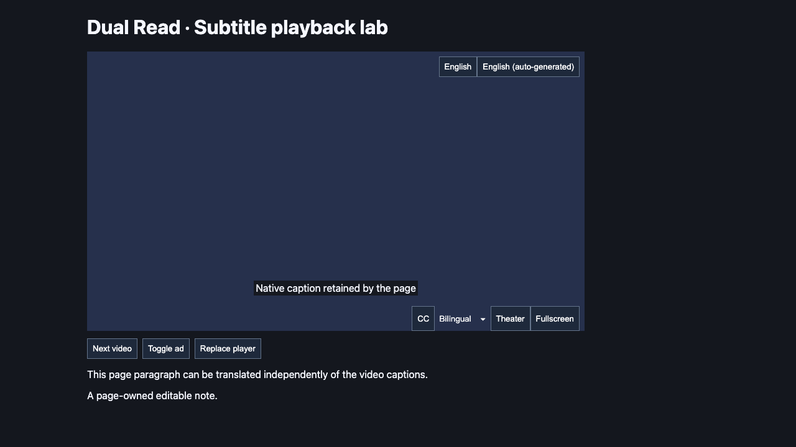

# YouTube player controls before translation

Date: 2026-10-25. Version retained at **0.2.0**.
Baseline: `19ff873` (full-track recovery and realtime continuity fix).

## Report and cause

The player button appeared only after clicking Enable in the toolbar popup.
The previous implementation created `SubtitleRenderer` inside `begin()`, after
starting a translation session. Its registered YouTube bootstrap was also tied
to the automatic-translation preference, so granting host access alone could
not provide a manual entry point on a new watch page.

Before production changes, the new first-load and homepage-to-watch scenarios
reproduced missing controls on the baseline: both Chromium cases and the Firefox
homepage case failed with no matching button. The Firefox first-load attempt
hit a test-harness new-window/onboarding race before its assertion. The harness
now reuses the existing blank tab, as the other subtitle suites already do.

## Resulting behavior

- With YouTube host access, a top-frame bootstrap shows idle controls on watch
  pages even when `youtubeAuto` is false. This mounts only extension-owned UI;
  it does not query caption state, read caption text, toggle CC or translate.
- Without persistent access, opening the toolbar popup uses `activeTab` to show
  controls on the current page. The first manual Enable click may request the
  existing optional `https://www.youtube.com/*` grant. Its explanatory hint is
  shown only when needed. No setting, new permission or all-site grant is added.
- The explicit current-tab start is sent independently of that optional request.
  Denial leaves manual use available. `permissions.onAdded` registers controls
  even if the native permission dialog closes the popup. Permission requests
  begin in the original extension-page click stack for Firefox compatibility.
- Automatic translation remains a separate device-local preference, off by
  default. Explicitly disabled tabs remain disabled on reload/navigation;
  disabling automatic translation retains idle controls.
- Idle controls wait for late CC controls, recover from player/control replacement
  without duplicate buttons, and disappear on non-watch pages or disabled sites.
  Revoking host access unregisters future bootstrap injection and destroys idle UI.
- Page-generated button clicks cannot start translation. Browser-generated
  mouse/keyboard activation still uses the existing manual session path.

## Restoration and validation contract

Tests preserve native caption node identities and text, check that CC stays off
and native captions stay visible before activation, and assert zero caption and
provider requests during idle mounting. After an actual click, the normal
translation path must work; after closing it and reloading, only the idle button
returns. Control replacement must not move or replace page-owned nodes.

Seven new browser scenarios run on fresh production bundles for each engine:
first load, reload after closing, homepage SPA navigation, late controls, replaced
controls, replaced player, and disabled site. Existing reload/native-off tests now
assert a visible disabled control plus `enabled: false`, instead of absence of
all extension UI. Their translation/ownership assertions are retained.

Eight new unit tests cover idle mounting/restoration, simulated-click rejection,
host registration/revocation, activeTab-only popup mounting, and granted/denied
permission requests in the original click stack. Native permission prompt UI
is not clicked by these tests; browser integration uses a disposable test-only
host grant and control relay around the production bundles.

## Final verification

TypeScript, ESLint and the store/privacy consistency check passed. Vitest passed
**2,053 tests across 54 files**. The fresh Chromium and Firefox builds passed
**176 distinct browser cases**, 88 per engine:

| Suite | Chromium | Firefox |
| --- | ---: | ---: |
| Source bridge | 32 | 32 |
| Production subtitle flow | 24 | 24 |
| Earlier review regressions | 17 | 17 |
| Source recovery and realtime continuity | 8 | 8 |
| Idle player controls | 7 | 7 |

The full run produced 174 passes and two nested-control expectation failures.
That older test recorded every control child before activation; with the new
idle UI, its expected list incorrectly included the extension's own button.
The corrected expectation records only page-owned nodes and still checks their
identity and order after disposal. Both corrected cases passed on the same
runtime builds. No production code changed between the full and focused runs;
the package build record preserves both run summaries.

The production manifests are identical to the previous 0.2.0 package, with no
new permissions or static content scripts. ZIP integrity checks passed; all 64
runtime/manifest files match their unpacked builds byte for byte. File hashes
were captured before browser testing and checked again at packaging. Credential
and test-relay scans passed. The earlier 0.2.0 package is archived locally.

Screenshots are controlled, muted fixture pages showing a disabled entry point
after homepage-to-watch navigation, with no caption/provider requests:

