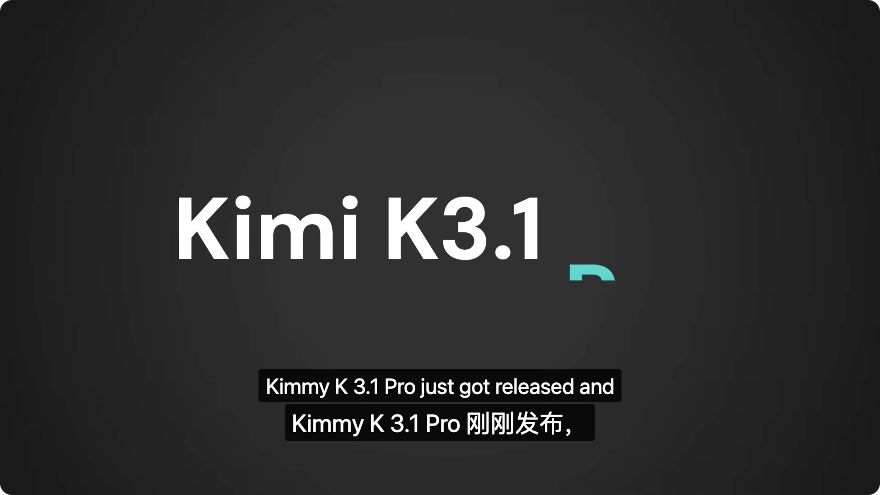

# YouTube nested controls and stuck Retry regression

Date: 2026-10-25. Reported with the 0.2.0 manual-test package and
<https://www.youtube.com/watch?v=3bM5tn52gxQ>.

## Finding

Automatic captions are supported. The authenticated, muted Chromium in-app
browser returned English ASR track `a.en`: 129,552 bytes, 380 JSON3 events,
190 text events. Production normalization generated 190 cues and preserved
the order of all 1,220 words. A replay with CC already enabled took 1,230 ms;
activating the production CC lease from CC off captured the native response
in 247 ms and restored CC to off after release.

The live player's structure was:

```text
.ytp-right-controls
  .ytp-right-controls-left
    .ytp-subtitles-button
    .ytp-settings-button
```

The old renderer called `outerContainer.insertBefore(control, cc.nextSibling)`.
The reference sibling belongs to the inner group, so this throws before the
session reaches subtitle acquisition. Failed setup also left inserted UI nodes
behind. Since the session only remembered its player after successful setup,
each 500 ms poll treated the same player as new and retried initialization.
Each failure moved `retryAt` five seconds into the future. This explains the
combination of a source error without a source-language label and an indefinitely
disabled Retry button; the error label had hidden a UI initialization failure.

The user's installed Edge session was not instrumented. The exact structure
was observed on the supplied live video, and the same failure chain was
reproduced on both production addon builds using that structure.

## Fix and restoration contract

- Insert the bilingual control immediately after CC in its actual parent.
- Remember the player/video before constructing the renderer, so failure waits
  for explicit retry or an actual player/navigation change.
- Dispose partially constructed UI, observers and page listeners on failure.
- Keep the existing controls, preferences, permissions and five-second cooldown.

Native caption and control nodes retain their identity and order. Native text
and page-added nodes are preserved through manual-to-ASR selection, two stop
operations, and content-script reinjection. Failure cleanup removes only the
renderer’s own elements and attributes.

## Validation

Before the production fix, the nested-controls regression failed in both
Chromium and Firefox. The new initialization tests separately reproduced three
leftover UI elements and 13 initialization attempts in six seconds.

After the fix, the two initialization regressions pass, including the actual
popup button becoming enabled and successfully issuing a retry. Full Vitest:
2,031 tests across 50 files pass. TypeScript and ESLint pass.

The 80 existing production-addon subtitle checks pass across Chromium and
Firefox. The new nested-controls checks pass in both browsers on fresh 0.2.1
builds: 82 distinct browser checks total. An initial run's two new checks reached
the restoration assertions but used the wrong localized button label; correcting
the test label and rerunning them passed (2.6 s Chromium, 3.9 s Firefox).

Final 0.2.1 ZIPs pass integrity, production-manifest, permission, credential and
test-relay checks. All 62 non-manifest runtime files are byte-identical to the
build used for the full regression run; the manifests differ only in version.
Manual-test archives and unpacked copies are in `dist/0.2.1/`, separate from
the original `dist/0.2.0/` artifacts. No release or tag was published.

The live page also passed a component integration check using the production
renderer, production ASR source/normalizer, and three captions translated by
the configured MiMo service. The service made one request, returned HTTP 200,
used 371 tokens, and took 2,543 ms. This was a bounded sample, not a translation
of the entire video. The renderer was removed afterward, native captions were
visible again, and the muted/paused diagnostic tab was closed.



The live screenshot verifies component rendering in the signed-in Chromium
page, not a complete installed-addon run there. Browser addon regressions use
controlled sources and a local mock provider. Authenticated live YouTube in
Firefox remains unverified because the previous login attempt was blocked.
